<!-- Cards are generated from docs/assets/cards.json with repo-polish (tools/cards/cards.py). Regenerate after editing it. -->

<picture>
  <source media="(prefers-color-scheme: dark)" srcset="docs/assets/hero-dark.svg"/>
  
</picture>

<p align="center">
  <a href="#-see-it-work"><b>Demo</b></a> &nbsp;·&nbsp;
  <a href="#-how-it-works"><b>Architecture</b></a> &nbsp;·&nbsp;
  <a href="#-run-it"><b>Run it</b></a> &nbsp;·&nbsp;
  <a href="docs/"><b>Docs</b></a> &nbsp;·&nbsp;
  <a href="#-whats-next"><b>What's next</b></a>
</p>

Built while working on a six-app delivery platform (customer web and mobile apps, an admin console, a rider app and two backends), to see where a change lands before making it, and what Claude Code read and changed while making it.

## ▸ See it work

<p align="center">
  
</p>
<p align="center"><sub>Real index of a six-app project (642 files). The Live part is a recorded 3½-minute Claude Code session, fed back in as hook events and played with <b>Replay</b> (prompt typo tidied). Script: <a href="docs/demo/">docs/demo/</a>.</sub></p>

<picture>
  <source media="(prefers-color-scheme: dark)" srcset="docs/assets/capabilities-dark.svg"/>
  
</picture>

## ▸ How it works

<picture>
  <source media="(prefers-color-scheme: dark)" srcset="docs/assets/architecture-dark.svg"/>
  
</picture>

<picture>
  <source media="(prefers-color-scheme: dark)" srcset="docs/assets/flow-dark.svg"/>
  
</picture>

<picture>
  <source media="(prefers-color-scheme: dark)" srcset="docs/assets/decisions-dark.svg"/>
  
</picture>

<picture>
  <source media="(prefers-color-scheme: dark)" srcset="docs/assets/editor-dark.svg"/>
  
</picture>

More detail, with diagrams of a tool call and of indexing: [docs/architecture.md](docs/architecture.md).

## ▸ Built with

<picture>
  <source media="(prefers-color-scheme: dark)" srcset="docs/assets/stack-dark.svg"/>
  
</picture>

## ▸ Run it

You need **Python 3.11+** (tested on 3.11 to 3.15), **Node.js** (tested on 24.16) and **curl**. No Python packages and no build step. Claude Code is optional: without it you get every view except Live.

<picture>
  <source media="(prefers-color-scheme: dark)" srcset="docs/assets/terminal-dark.svg"/>
  
</picture>

### Quick start (about a minute)

**1 · Install** (TypeScript is the only Node package; it parses `.ts` / `.tsx`)

```bash
git clone https://github.com/Aryan-yadav15/wiretap && cd wiretap
npm install
```

**2 · Start the map** → http://127.0.0.1:7878

```bash
python3 -m wiretap serve --open
```

**3 · Connect Claude Code (once)**, in a second terminal inside the `wiretap` folder

```bash
python3 -m wiretap install-hooks
```

This adds the hooks to `~/.claude/settings.json` (after a backup) and puts the **◉ Wiretap live ↗** button above the Claude Code prompt, plus `/wiretap`. The hooks do nothing while the server is down, and the button starts it.

**4 · Use it.** Open a **new** Claude Code session in any of your projects and ask it something. Wiretap maps that folder the first time a hook arrives from it, and the Live view follows the session. Press the button to jump to it.

When it maps a project, the server prints what it understood: routes, tables and HTTP calls per app, by framework, and anything it couldn't read (another language, a library with no adapter). To check a project without starting anything, run `python3 -m wiretap index --root path/to/project` (add `--explain <file>` for one file).

No config needed: each folder Claude works in gets its own map (one app per `package.json` and per `pyproject.toml` / `requirements.txt`, up to 5,000 code files, never your home folder). The map's cache stays in the Wiretap folder, never in your project.

### Map a project before Claude touches it (optional)

A config fixes the apps, route prefixes and databases for one project, and maps it as soon as the server starts:

```bash
cp wiretap.config.example.json wiretap.config.json
```

Set `root` and list the apps (every key is described in [docs/setup.md](docs/setup.md#configuration)), then check what it finds without starting the server:

```bash
python3 -m wiretap index
```

<details>
<summary><b>Troubleshooting</b></summary>

| Problem | Fix |
|---|---|
| Live stays on "Waiting" | Hooks load when a session starts: open a **new** Claude Code session after `install-hooks`. |
| Port 7878 is taken | `python3 -m wiretap serve --port 7879` and `python3 -m wiretap install-hooks --port 7879`. The terminal button still opens 7878 (see [What's next](#-whats-next)). |
| "too many to map on the fly" | The folder has more than 5,000 code files. Give it a config (above). |
| "This is your home folder, not a project" | Start Claude Code inside a project folder. |
| See the settings before writing them | `python3 -m wiretap install-hooks --dry-run` |
| Remove Wiretap from Claude Code | `python3 -m wiretap uninstall-hooks` removes the hooks and the button. |

Setting `WIRETAP_SKIP=1` in a shell silences the hooks for Claude Code sessions started from it. More in [docs/setup.md](docs/setup.md).

</details>

<details>
<summary><b>The views</b></summary>

| View | What it answers |
|---|---|
| **System** | Which apps talk to which backends, databases and outside services, with counts, and how complete the map is (unmatched API calls, calls it couldn't follow). Double-click an app to go into its folders. |
| **Folders** | One level of an app at a time: the folders and files inside it in the middle, what uses it on the left, what it uses on the right (a sibling folder, another app, a database, an outside service). Click a folder to go in, a file to open it on the map; Backspace goes up. |
| **Map** | One file, table, service or resource in focus: what uses it on the left, what it reaches on the right, as many columns deep as you pick. Line colour says what a link carries (calls, API calls, data, renders, outside service) and width how many links it stands for; hover a line for the details, hover a box to fade everything it isn't linked to. Click a box to move, click the focused box to look inside, click a line to see the calls behind it. **Columns: by role** switches to fixed lanes (screens, routes, logic, data). |
| **Inside a file** | Its functions, who calls in and what they call out to. Click a function for its callers, its calls, **where the flow starts** (a tap, a screen opening, an API route, startup or a scheduled job), and its code. |
| **Live** | The Claude session as it happens, in whichever project Claude is working in. A change is drawn as **areas**: one box per folder in each layer (API routes, backend logic, data…), with how many files in it changed, are new or use changed code, and the calls between areas. Click an area to open its files in place (changed functions as `+ added ~ changed`, and for each file that uses changed code, which changed function it reaches), click a file for its functions and code. Green = changed, teal = new, amber = uses changed code (recheck it), **!** = probably not needed: outside the plan, or linked to nothing else in the change by a call, import or table. The status line sums it up (files, areas, files to recheck, test results), and a slow command shows as running until it returns; a session that only queried data lists the tables it touched. Reports from subagents stay part of the request they belong to. The steps sit in a drawer under the map, grouped into phases; hovering a phase lights up the files it touched. A question-only session is drawn as one row per flow, numbered in the order Claude looked. **Summarize with Claude** runs `claude -p --model haiku` on the diff only when pressed. Your own edits show up too. |
| **Trace** | Type the words a feature uses (`cod, pay_later, payLater`). Finds every function that uses them as an identifier, plus functions that touch the same feature-specific tables. |
| **Resources** | Shared things that can stall everything: the worker thread pool, a shared database client, a session pool. Who uses each one. |

Zoomed out, boxes show only their title in large type, so a big map stays readable. On every map: drag a box to move it, drag a column's background to move the whole column, shift-drag on empty space to pick several boxes and drag them together, scroll to pan, ⌘ / Ctrl + scroll to zoom. **Reset layout** puts everything back. The sidebar, the side panel and the canvas height can be resized or collapsed, and panel sections fold; those sizes are remembered.

**Raw / Simple**, top right of every canvas (`S`): Simple puts plain-English names written by Claude on files and functions (`claude -p --model haiku`, about one call per file drawn, 8 at once, cached until that code changes), with the code's own name kept as the second line and small private helpers folded into one row. Picking a function also names its flow from where it starts, step by step. The links never change: they always come from the parser. Off by default; `python3 -m wiretap describe` fills the names for a whole project ahead of time. See [ADR 0006](docs/decisions/0006-simplify-layer.md).

Keys: `/` search, `[` `]` hide the sidebar or the panel, `F` fit the map, `S` Raw / Simple, Backspace up a folder, and on Live ← → step, `R` replay. When more than one project is mapped, pick one at the top of the sidebar.

</details>

<details>
<summary><b>Project structure</b></summary>

```
wiretap/                    the server: CLI, parsers, linker, sessions, HTTP + SSE
wiretap/adapters/           one file per framework: FastAPI, Flask, Express, Next.js, Supabase, SQLAlchemy, Prisma, …
web/                        the UI (plain HTML, CSS, JS; no build step; vendor/elk is the layout library)
claude-mod/wiretap-live/    Claude Code mod: the button above the prompt and /wiretap
tests/                      unittest suite and fixture projects (FastAPI, Express, Next.js, Flask, Prisma)
docs/                       architecture, codebase, setup, API, decisions; cards and diagrams
```

Folder-by-folder detail: [docs/codebase.md](docs/codebase.md). Run the tests with `python3 -m unittest discover -s tests -v`.

</details>

## ▸ What's next

- **Only Python and TypeScript/JavaScript.** Go, Java, Ruby and others aren't parsed; `index` and the System view count those files rather than skip them silently. Routes are read for FastAPI, Flask, Express, Fastify, Hono, Next.js and Expo Router; tables for Supabase, SQLAlchemy and Prisma. NestJS, Django, Drizzle, TypeORM and others have no adapter yet, and the coverage report names them when a project uses them. Adding one is a single file: [docs/adapters.md](docs/adapters.md). Stylesheets are read rule by rule (so Live can say which rules changed), but not linked to the components that use them.
- **Static analysis has blind spots.** Calls through strings, dependency injection, Redux `dispatch` or websocket managers can't be followed. They're counted in the System view (252 on the project above) rather than hidden.
- **Live sessions live in memory.** Restarting the server clears them, and projects mapped on the fly are mapped again (from their cache) when Claude next works there. Writing sessions next to the cache would keep history across restarts.
- **Moved boxes aren't saved.** Dragged positions last until the page reloads (panel sizes and folds are remembered, box positions are not).
- **The terminal button assumes port 7878.** `serve --port` and `install-hooks --port` move the server and hooks, but not the button.
- **No runtime data.** The Resources view shows who *could* hold the thread pool or the database client. Overlaying real request timings would show who *did*.
- **Planning on the map.** Sketching planned files and functions as dashed boxes before any code is written (to compare an adapter with code inside an existing module, for example) isn't built yet.

<sub>Full documentation: [docs/](docs/) — [architecture](docs/architecture.md) · [codebase](docs/codebase.md) · [setup](docs/setup.md) · [API](docs/api.md) · [decisions](docs/decisions/)</sub>

<sub>MIT licensed. See [LICENSE](LICENSE). Want your framework read? See [CONTRIBUTING.md](CONTRIBUTING.md).</sub>
