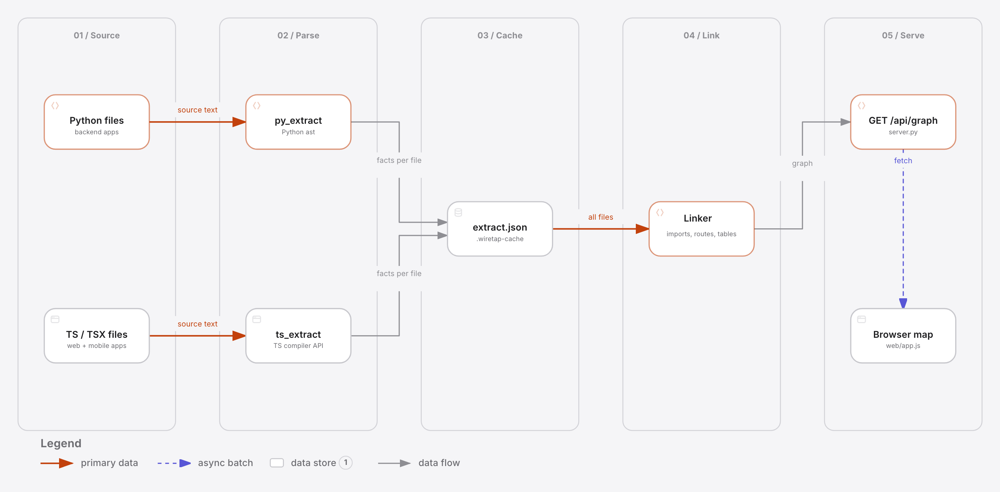

# Architecture

Wiretap is one local Python process. It parses a project's Python and TypeScript files into a graph (apps, files, functions, API routes, tables, outside services, and the links between them), keeps that graph current as files change, and serves it to a browser UI. Claude Code reports each tool call to the same process through hooks, so the UI can show what Claude reads and changes on top of the graph. Nothing runs inside your project and nothing leaves your machine.

## Components

| Component | Responsibility | Code |
|---|---|---|
| CLI | `serve`, `index`, `install-hooks`, `uninstall-hooks` | [`wiretap/__main__.py`](../wiretap/__main__.py) |
| Python parser | functions, calls, imports, FastAPI routes and router prefixes, Supabase / SQLAlchemy table use, thread-pool and background-task use | [`wiretap/py_extract.py`](../wiretap/py_extract.py) |
| TypeScript parser | functions, components, handlers, `api.get/post` and `fetch` URLs, JSX `onClick` / `onPress`, renders, direct Supabase calls | [`wiretap/ts_extract.mjs`](../wiretap/ts_extract.mjs) |
| Project + linker | which files to read, the extraction cache, and linking: imports, HTTP calls to routes, tables, resources, where flows start | [`wiretap/graph.py`](../wiretap/graph.py) |
| Sessions | turns hook events into a timeline: reads (including shell `grep` / `sed`), plan, function-level diffs, tests | [`wiretap/session.py`](../wiretap/session.py) |
| Server | HTTP + server-sent events, file watcher, hook queue, feature-trace search, optional summary | [`wiretap/server.py`](../wiretap/server.py) |
| UI | System, Map, Inside a file, Live, Trace, Resources views; plain JS + SVG, no build step | [`web/`](../web/) |
| Terminal button | a Claude Code mod: "◉ Wiretap live ↗" above the prompt and `/wiretap` | [`claude-mod/wiretap-live/`](../claude-mod/wiretap-live/) |

## How they communicate

- **Browser ↔ server:** plain HTTP for the graph, source excerpts, search and sessions; one long-lived server-sent-events stream (`/api/stream`) pushes graph and session updates to every open tab ([`server.py:322`](../wiretap/server.py#L322)).
- **Claude Code → server:** each hooked event runs one `curl` that POSTs the hook payload to `/api/hook` ([`__main__.py:23`](../wiretap/__main__.py#L23)). The server answers before doing any work and queues the payload ([`server.py:356`](../wiretap/server.py#L356)); one worker thread processes the queue in order ([`server.py:58`](../wiretap/server.py#L58)).
- **Server → TypeScript parser:** a Node child process per batch of files, reading JSON on stdin and writing JSON on stdout ([`graph.py:209`](../wiretap/graph.py#L209)).
- **Server → Claude:** only when you press **Summarize with Claude**: `claude -p --model haiku` with the git diff on stdin ([`server.py:230`](../wiretap/server.py#L230)).

## Main flow: what happens on one Claude Code tool call

<picture>
  <source media="(prefers-color-scheme: dark)" srcset="diagrams/live-hook-dark.svg"/>
  
</picture>

[Interactive version](diagrams/live-hook.html), with source links. Download and open it in a browser.

1. Claude Code runs the hook: one `curl -m 1` POST that always exits 0 ([`__main__.py:23-26`](../wiretap/__main__.py#L23-L26)). The hooked events are SessionStart, UserPromptSubmit, PreToolUse (Bash), PostToolUse (Read, Edit, MultiEdit, Write, NotebookEdit, Bash, ExitPlanMode, Grep, Glob) and Stop ([`__main__.py:29-37`](../wiretap/__main__.py#L29-L37)).
2. The server answers `200` and puts the payload on a queue ([`server.py:356-360`](../wiretap/server.py#L356-L360)).
3. The worker calls `Sessions.on_hook` ([`server.py:85-93`](../wiretap/server.py#L85-L93), [`session.py:300`](../wiretap/session.py#L300)). Reads and searches are recorded with the functions on the lines Claude saw ([`session.py:231`](../wiretap/session.py#L231)); edits re-parse that one file ([`session.py:371`](../wiretap/session.py#L371)) and diff it per function ([`session.py:134`](../wiretap/session.py#L134)).
4. The server pushes the session snapshot over SSE ([`server.py:94`](../wiretap/server.py#L94)); the Live view redraws.

## Second flow: how a codebase becomes the map

<picture>
  <source media="(prefers-color-scheme: dark)" srcset="diagrams/indexing-dark.png"/>
  
</picture>

[Interactive version](diagrams/indexing.html), with source links.

1. `Project.scan` lists each app's files and re-extracts only those whose modification time or size changed ([`graph.py:148`](../wiretap/graph.py#L148)). A watcher runs it every second ([`server.py:97`](../wiretap/server.py#L97)).
2. Python files are parsed with `ast` ([`py_extract.py:321`](../wiretap/py_extract.py#L321)); TypeScript files with the TypeScript compiler API, without type checking ([`ts_extract.mjs:86`](../wiretap/ts_extract.mjs#L86)).
3. Extractions are cached in `.wiretap-cache/extract.json` ([`graph.py:140`](../wiretap/graph.py#L140)).
4. The linker turns per-file facts into one graph: resolves imports and aliases, matches each API call to a backend route by method and path segments ([`graph.py:713`](../wiretap/graph.py#L713)), maps table reads and writes, and finds where each flow starts (a tap, a screen opening, a route, startup or a scheduled job).
5. The browser fetches `/api/graph` once and again whenever the server announces a new graph version.

## What the parsers understand

- **Python / FastAPI**: functions, methods and nested functions; imports (including relative ones); `APIRouter(prefix=…)` and `include_router(…, prefix=…)` chains; route decorators; Supabase `.table("x").select/insert/update/…` (read vs write) and `.rpc()`; SQLAlchemy models via `__tablename__`; `run_in_threadpool`, `asyncio.to_thread`, sync `def` endpoints (these use the thread pool too); `on_event("startup")`, `create_task`, `add_job`, `BackgroundTasks.add_task`; outside SDKs (Razorpay, Firebase, …) and HTTP calls to known hosts.
- **TypeScript / React / React Native**: functions, components, handlers nested in components, object-of-functions exports (`admin.getZones`), class instances (`orderService.getMyOrders`), re-exports, `@/` aliases; `api.get/post/…` and `fetch` calls with URLs from literals, template strings and constants like `API_ENDPOINTS.X(id)`; JSX `onClick` / `onPress` handlers (with the button text); `<Component/>` renders; direct `supabase.from("table")` calls; hooks like `const { addItem } = useCart()` (marked as a guess).
- Each API call in an app is matched to its backend route (method + path, `{param}` aware). Calls that hit no route are listed under System.

## Key decisions

- **Watching costs no tokens.** Claude never reads the map; the hook is a fire-and-forget `curl`. ([ADR 0001](decisions/0001-zero-token-hooks.md))
- **Read code, don't run it.** No app has to start; a cold index of a 638-file, six-app project took 1.7 s. ([ADR 0002](decisions/0002-static-parsing.md))
- **Function-level diffs.** Each function's body is hashed at parse time, so edits are reported per function and their callers can be traced. ([ADR 0003](decisions/0003-function-level-diffs.md))
- **Questions drawn as flows.** When Claude only reads, Live draws one row per flow it followed, instead of a file graph. ([ADR 0004](decisions/0004-question-mode-strands.md))

## Known limits

- Calls made through strings, dependency injection, Redux `dispatch` or websocket managers can't be followed statically. They're counted and listed under "Calls the map could not follow" in the System view.
- Only Python and TypeScript/JavaScript are parsed. HTTP matching assumes a backend whose routes are declared with FastAPI-style decorators.
- Live sessions are kept in memory; restarting the server clears them (the code index is cached).
- "Who held the thread pool during an incident" needs runtime data. The Resources view shows who *could* be involved, not who was.
